# Personal Agents OS

**Personal Agents OS is a personal knowledge graph you run with an AI agent.** It holds the people in your world and everything that connects them, kept current from your own stream (WhatsApp, meetings, email) as plain markdown you can browse as a graph. You can add a team of agents with a memory and a phone app that puts your whole life on one screen.

<p align="center">
  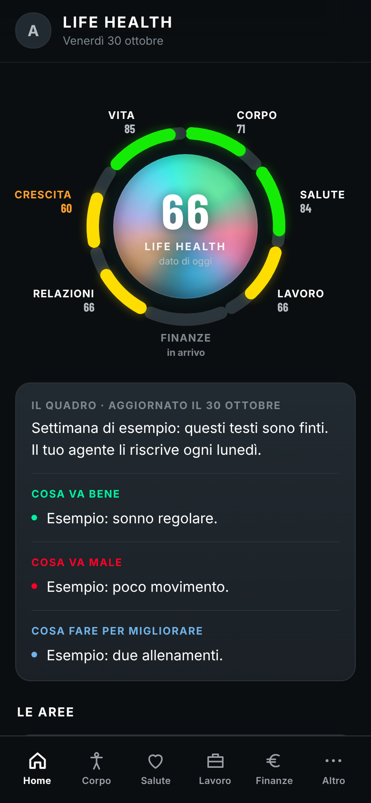
  &nbsp;
  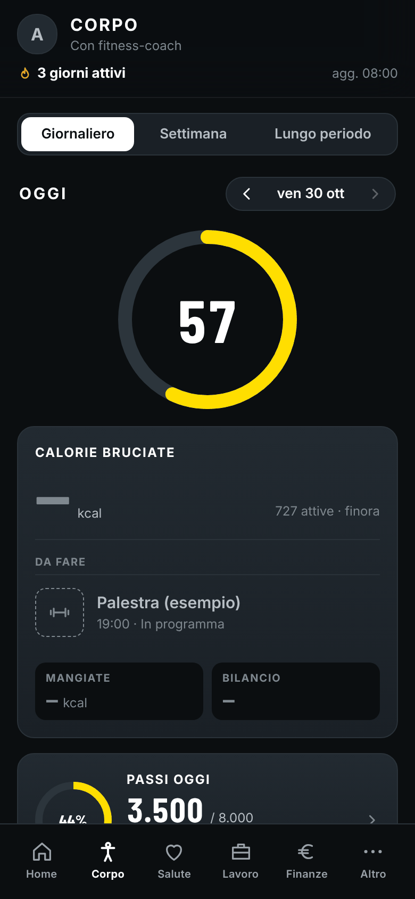
  &nbsp;
  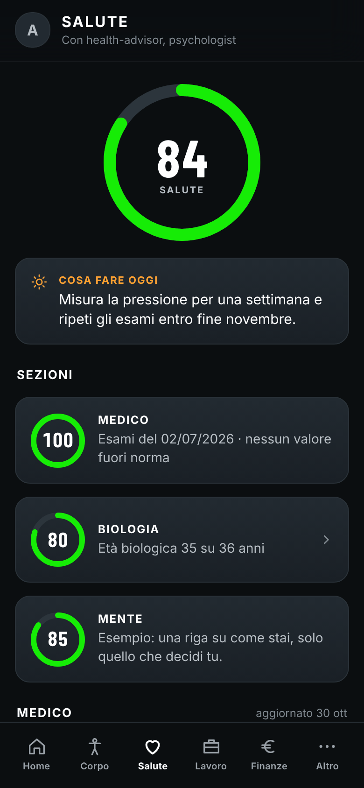
  &nbsp;
  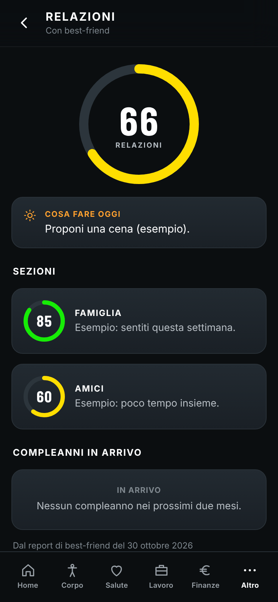
</p>
<p align="center"><sub>The optional <a href="#the-life-app">Life App</a>, built from the template's bundled <b>fake</b> sample data (every value says "esempio").</sub></p>

The value isn't storage. It's retrieval and connection: who you know in a city, who climbs, who introduced whom, where you take people, and what you left open with someone before you walk into the next meeting.

This repo is the **engine, empty**. Clone it, point it at your own sources, and your agent fills `data/`, which stays private on your machine. The repo explains itself: open it with Claude Code (or any agent that reads `AGENTS.md`) and the agent already knows how to work in it.

**You don't need any external service.** Notion, a calendar, a wearable and even WhatsApp are all optional. With an empty `config.local.yml`, the graph, tools, skills and agents work from what you tell them, and `data/` holds every fact. Each source you wire in adds to it, and an optional tool that isn't set up reports "not configured" instead of failing.

---

## Contents

- [Rule zero: the personal detail comes first](#rule-zero-the-personal-detail-comes-first)
- [Features](#features)
- [How it works](#how-it-works)
- [Repository layout](#repository-layout)
- [Quick start](#quick-start)
- [Agents, memory and routines](#agents-memory-and-routines)
- [The Life App](#the-life-app)
- [Rules that keep it alive](#rules-that-keep-it-alive)
- [Privacy](#privacy)
- [Credits and license](#credits-and-license)

---

## Rule zero: the personal detail comes first

**Everyone who touches this repo, human or agent, has to remember this first.** The graph exists for the human layer, and that layer has to be captured in **specific, personal detail**, never in general terms:

- **Who someone is**, not just that they came up: where they're from, their life story, family, health, feelings, fears, ambitions, character, and what they're going through.
- **The reasons behind their choices and the experiences they lived**, told concretely and **in their own words** (quote them). "She founded a company" is worthless. "She bootstrapped it for two years after her co-founder walked, because she refused to raise on someone else's terms" is the memory.
- **The human layer matters more than the work content, every time.** Every meeting and every message gets mined for it, even a call that was "about work". A work-only log is a failed capture.
- **Proper names, first and last:** partners, children, parents and siblings, close friends, who introduced whom, investors and who backs whom, where people are from and where they live now. If you learn that a partner or an investor exists but not their name, that's a **gap to chase**, not a fact to file. The repo tracks it in the gap register until it's closed.

The graph mechanics described below exist to serve this rule. They don't replace it.

## Features

**The core** (everything else is optional):

- **A typed, bidirectional graph** of people and the entities that connect them: places, passions, cities, groups, bonds, roles, events, terms and media. Each node is a markdown file with frontmatter links. The memory model is in [`anatomy.md`](anatomy.md), and the exact field-and-edge contract is in [`LEGEND.md`](LEGEND.md).
- **Tooling that keeps the graph honest** (`tools/`). Agents record well but connect badly, and a freehand fix to frontmatter can corrupt it without anyone noticing. Code enforces the shape:
  - `graph.py` is the only approved frontmatter reader and writer. It edits by line and re-checks its own changes.
  - `lint.py` + `checks.py` apply mechanical fixes (`--fix` writes every reverse edge, removes duplicates and normalises) and list the gaps to chase. A run isn't finished until it prints `mechanical: 0`.
  - `gaps.py` is **the gap register**: what the memory knows it doesn't know, tracked over time with first-seen date, attempts and the evidence that closed each gap.
  - `merge.py` / `rename.py` make sure a person is never split into two nodes, and let a placeholder slug switch to the real name once it arrives.
  - `owed_backfill.py` measures which days of your stream still have no log. `rebuild_followups.py` rebuilds missing work digests from logs already in the graph.
- **Skills** the agent runs:
  - [`remember-people`](skills/remember-people/SKILL.md) logs every exchange, keeps a profile per person that gets sharper over time, links the connecting entities from your stream, runs the cross-person **graph pass** and writes a **pre-meeting brief**.
  - [`graph-audit`](skills/graph-audit/SKILL.md) is the weekly view from above. It finds who keeps sharing rooms without being connected, which node types stayed empty, and which gaps have been open for weeks.
  - [`notion-sync`](skills/notion-sync/SKILL.md) (optional) reconciles People and Companies with your Notion.
- **Works with Obsidian:** point a vault at the folder and the graph view runs on top of it.

**Optional modules**, each switched on in `config.local.yml` and documented in [`anatomy.md`](anatomy.md):

- **Agents**: thirteen ready-made roles with a memory, each with suggested routines ([details below](#agents-memory-and-routines)).
- **The body layer**: wearable data (sleep, heart, sessions) becomes one node per day and is matched by time to who you saw and where. It also includes a food log, a training log and lab reports (`tools/body.py`, `body-pull.sh`, `food.py`, `calories.py`, `sleep_fields.py`).
- **The location layer**: your phone's GPS (through the Overland app and a small receiver you host) plus a Google Maps Timeline export, both kept outside the repo. A meeting can get a place without anyone mentioning it (`tools/location.py`, `location-pull.sh`).
- **[The Life App](#the-life-app)**: your whole life on one encrypted phone screen.

## How it works

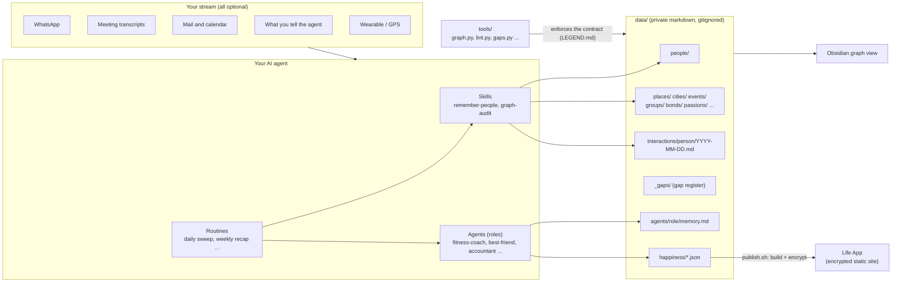

1. **The stream comes in.** You talk to the agent, or it reads the sources you've wired up in `config.local.yml`.
2. **The `remember-people` skill writes it down.** Each exchange goes into `data/interactions/<person>/YYYY-MM-DD.md`, the person's profile gets sharper, and the entities that connect people (places, events, groups, bonds and so on) become nodes when they come up again.
3. **The tools keep it consistent.** `lint.py --fix` writes every reverse edge, and `gaps.py` tracks what's still unknown.
4. **Agents work on top of the shared graph,** each with its own memory under `data/agents/<role>/`.
5. **Optional: the Life App.** Agents write one JSON file per life area into `data/happiness/`, and `publish.sh` turns that into an encrypted phone app.

## Repository layout

```
personal-knowledge-graph/
  README.md
  AGENTS.md / CLAUDE.md          # how an agent must work in here (read first; identical files)
  LEGEND.md                      # the field-and-edge contract the tooling enforces
  anatomy.md                     # the memory model, node map, rules, optional modules
  config.example.yml             # copy to config.local.yml (gitignored)
  SETUP-WHATSAPP.md              # wiring the WhatsApp bridge
  tools/
    graph.py                     # the only sanctioned frontmatter reader/writer
    checks.py  lint.py           # every check as data; mechanical fixes (--fix) + gaps (--gaps)
    gaps.py                      # the gap register: sync / today / attempt / close / drop / trend
    merge.py  rename.py          # one human = one node; placeholder slug -> real name
    owed_backfill.py             # which days of the stream still have no log
    rebuild_followups.py         # rebuild missing work digests, behind the wall
    body.py  body-pull.sh        # optional: the body layer
    food.py  calories.py         # optional: food log, daily calorie estimate
    location.py  location-pull.sh  # optional: the location layer
    sleep_fields.py              # optional: per-night sleep fields from the wearable CLI
    happiness.py                 # validate / init / inject / recap data/happiness/*.json
    life-app/                    # optional: the Life App (setup.sh, publish.sh, sample-data/, src/)
    agents/create_agent.py       # optional: create an agent from its role
    git-sync.sh  wt.sh           # safe git sync / one worktree per agent on a shared machine
    template_sync.py             # maintainers: bring app updates from an upstream instance, leak-checked
  skills/
    remember-people/             # the core engine (+ templates for person, interaction, media)
    graph-audit/                 # the weekly look from above
    notion-sync/                 # optional
    <role>/                      # thin launchers for the agents
  agents/
    README.md                    # onboarding, rules every agent inherits, who remembers what
    _template/                   # skeleton for a new role
    <role>/AGENT.md              # spec: persona, lane and handoffs, memory, routines, flows
    <role>/memory-skeleton/      # empty memory files (headings only, no facts)
    <role>/routines/<slug>.md    # suggested routine specs (schedule, intent, when silent)
  docs/images/                   # README screenshots (sample data only)
  .claude/hooks/git-sync.sh      # optional: pull on session start, commit + push on stop
  .githooks/pre-commit           # optional guard (git config core.hooksPath .githooks)
  data/                          # PRIVATE, gitignored by default: your graph + your stream
    _me.md                              # the owner node (the point of view)
    people/  companies/  places/  passions/  cities/  terms/  groups/  events/
    bonds/   roles/   media/
    interactions/<slug>/YYYY-MM-DD.md   # recent, daily
    interactions/<slug>/YYYY-MM.md      # older months, rolled up
    _gaps/                              # the gap register
    _followups/                         # the work digest (no personal content, ever)
    body/  food/  training/  agents/    # only if you enable those modules
    happiness/                          # the Life App's data: one JSON per area
```

## Quick start

**Requirements:** `git` and `python3` for the graph. The Life App also needs `node` 18+ and `npm`, plus `gh` (logged in) if you want it to create the site repo for you.

1. **Clone and configure.**
   ```bash
   git clone <your fork of this repo>
   cd personal-knowledge-graph               # the repo slug; the project is Personal Agents OS
   cp config.example.yml config.local.yml   # edit: owner, owner_slug, owner_language, the sources you have
   git config core.hooksPath .githooks      # optional: the versioned pre-commit guard
   ```
   Every source is optional. With none, you log exchanges by hand and still build the graph.

2. **Connect WhatsApp** (the richest source) by following [`SETUP-WHATSAPP.md`](SETUP-WHATSAPP.md). You wire calendar, transcripts and mail the same way, in `config.local.yml`.

3. **Open the repo with your agent and talk to it.** For example:
   - "prepare the brief for Wren before our call"
   - "log my coffee with Oskar"
   - "run the daily sweep"
   - "lint the graph and show me the oldest open gaps"

   The agent reads [`AGENTS.md`](AGENTS.md) / [`CLAUDE.md`](CLAUDE.md), loads the contract, the anatomy and the skills, and knows what to do.

4. **Optional: create your agents.**
   ```bash
   python3 tools/agents/create_agent.py --list            # the roles, and which ones exist
   python3 tools/agents/create_agent.py fitness-coach     # invented persona name + memory skeleton
   ```

5. **Optional: the Life App on your phone.**
   ```bash
   bash tools/life-app/setup.sh --dry-run        # print every step, change nothing
   bash tools/life-app/setup.sh                  # your name, a password, sample data, first build
   bash tools/life-app/setup.sh --create-site    # + your own public GitHub Pages repo (needs gh auth login)
   ```

6. **Optional: git sync.** If you keep a **private** remote, the Claude Code hooks in `.claude/settings.json` run `.claude/hooks/git-sync.sh`. They pull at the start of a session and commit and push at the end. Set `git_sync: "off"` in `config.local.yml` to turn them off. See `CLAUDE.md`.

## Agents, memory and routines

An agent here is **a role with a memory**. It talks to you, reads the parts of the graph its job needs, and writes back what it learns, so each conversation starts where the last one ended. The graph is the shared memory, and an agent is one way of using it. The full rules are in [`agents/README.md`](agents/README.md).

**Thirteen roles ship ready to use, without names:**

| | | | |
| --- | --- | --- | --- |
| `fitness-coach` | `psychologist` | `founder-assistant` | `linkedin-coach` |
| `best-friend` | `brand-designer` | `accountant` | `health-advisor` |
| `web-builder` | `tech-maintainer` | `english-teacher` | `recruiter` |
| `legal` | | | |

Each role comes with:

- **`agents/<role>/AGENT.md`**: frontmatter (`name`, `persona`, `description`, `channel`, `reads`, `writes`, `requires`), then the persona, its lane and handoffs (what isn't its job and who owns that), the rules it never breaks, what it remembers and where, and its flows.
- **A memory skeleton** (`memory-skeleton/`): empty files with headings only. `create_agent.py` copies them into `data/agents/<role>/` and never overwrites an existing memory.
- **Suggested routines** (`routines/<slug>.md`, 48 in total), such as a daily graph lint, a weekly life recap, a meal reminder, a monthly grants scan or a birthdays-of-the-day ping. Each spec has a cron `schedule`, a `status` (`suggested` / `enabled` / `paused`), the intent, when it stays silent and the saved prompt.
- **A thin launcher** in `skills/<role>/SKILL.md`, so "/fitness-coach" or "talk to the fitness coach" starts it.

**How memory works:**

- **The persona is generated, not shipped.** `create_agent.py` fills `{{AGENT_NAME}}` with an invented name (or one you pick with `--name`) and prints the text to give your runner (a bot's system prompt, a project's instructions).
- **Memory lives in the repo, not only in the runner.** Whatever an agent saves in its runner's own memory also goes into `data/agents/<role>/memory.md` in the same turn, and shared facts go into the graph. Runners change, but the repo stays. The `tech-maintainer` sweeps daily for anything that was missed.
- **Routines are mirrored in the repo too.** Create, change, pause or delete a routine on a runner (Grok, cron, a scheduled task) and its `routines/<slug>.md` changes in the same turn. The `tech-maintainer` checks the two stay aligned.
- **One agent, one job.** When a conversation drifts into another agent's job, the agent hands over in one line and never shares the other agent's memory.
- **Evidence, not opinion.** An agent's own reads of you ("seems tired") stay in its log marked `(read)` and never go into a profile.
- **To add a role:** `python3 tools/agents/create_agent.py --new <role> --title "<title>"` copies `agents/_template/`.

## The Life App

**Your whole life on one phone screen.** It shows one number, **Life Health**, across seven areas, and the agent that owns each area keeps it up to date. It's a React app bundled into **one file** and **encrypted whole** (AES-256-GCM, with the key derived from your password using PBKDF2). It's published as a static site that contains only ciphertext. Add it to your home screen and it behaves like an app. Without the password, the site is noise.

| area (tab) | data file in `data/happiness/` | default owner |
| --- | --- | --- |
| Home: the Life Health ring and the weekly picture | `weekly-summary.json`, `life-health-history.json` | whoever writes the Monday recap |
| Corpo (body): calories, steps, sleep, training, trends | `corpo.json` (+ `corpo-history.json`) | fitness-coach |
| Salute (health): labs, check-ups, pills, mind | `medico.json`, `mente.json` | health-advisor, psychologist |
| Lavoro (work) | `lavoro.json` | founder-assistant, linkedin-coach |
| Finanze (money) | `finanze.json` | accountant |
| Altro: Relazioni, Crescita, Vita | `relazioni.json`, `crescita.json`, `vita.json` | best-friend |

On a wide screen (1024 px and up by default), the app switches to a **desktop layout** with a left sidebar and multi-column pages:

<p align="center">
  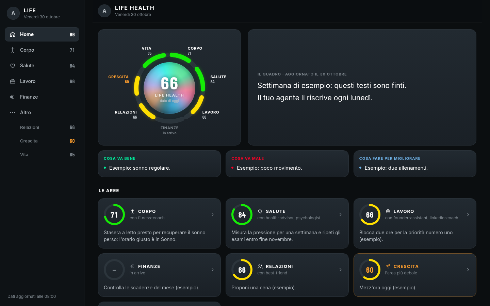
</p>

<details>
<summary><b>More screenshots</b> (all sample data)</summary>
<br>
<p align="center">
  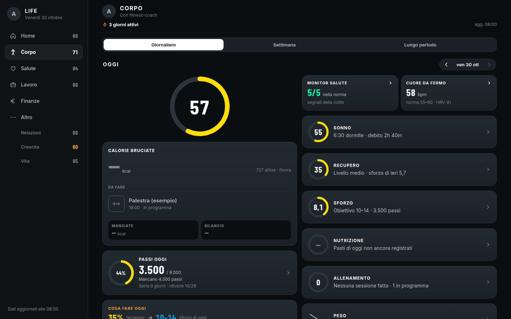
</p>
<p align="center">
  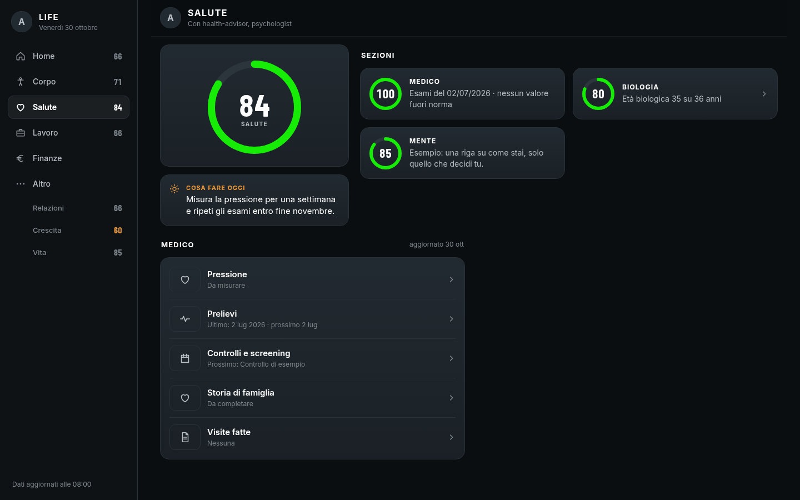
</p>
<p align="center">
  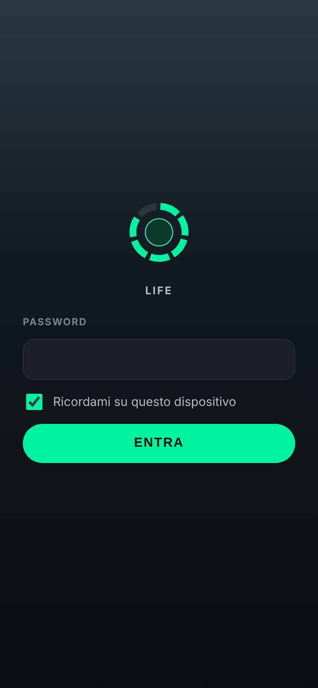
  &nbsp;
  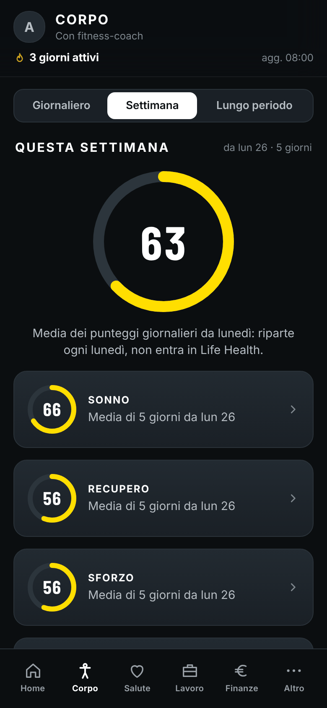
  &nbsp;
  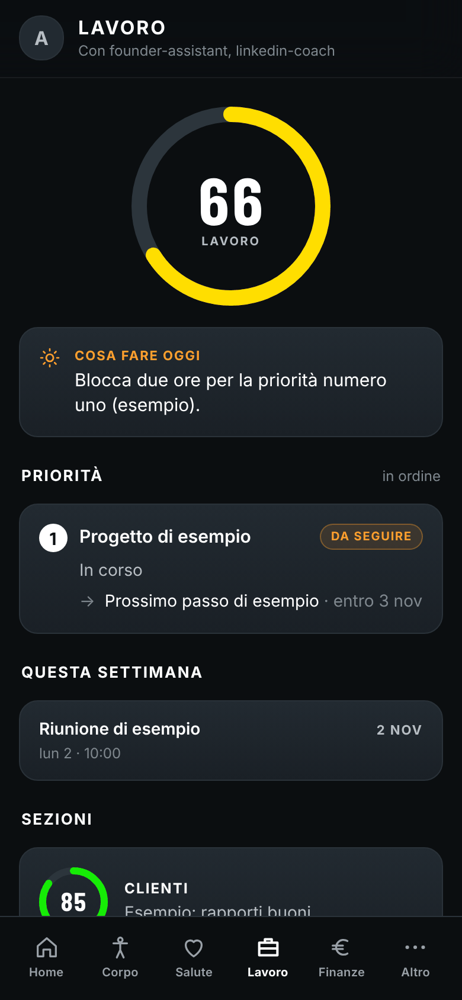
  &nbsp;
  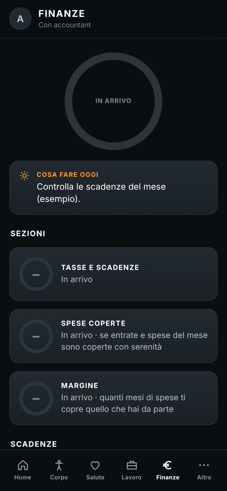
</p>
</details>

**What it does:**

- **One file per area, one owner per file.** An agent writes only its own JSON, only with facts it has a source for. It then runs `python3 tools/happiness.py validate` and `bash tools/life-app/publish.sh`.
- **The publish step** validates the data, builds and encrypts it into `tools/life-app/out/site/`, regenerates the markdown recaps next to the JSON, and pushes only if the build changed. The push goes to a **separate** public Pages repo, as a single commit that replaces the previous one.
- **Runs on a fresh clone.** It ships with obviously fake sample data (`tools/life-app/sample-data/`, every value marked "esempio"). `setup.sh` copies it into `data/happiness/` so there's something to show until your agents write real values.
- **Can be configured** under `life_app:` in `config.local.yml`: owner name, app name, language, timezone, area names, the agents shown for each area, each area's weight in Life Health, and whether Relazioni, Crescita or Vita is shown at all. The UI text is Italian today. `python3 tools/life-app/life_config.py` prints the resolved settings.
- **Optional write-back** (off by default): some taps (a pill taken, a weigh-in) can be saved as small event files in a **private** repo of yours. An agent then folds them into `data/`.
- **Headless check:** `node tools/life-app/verify.mjs` serves the build at phone size. It checks that a wrong password is refused, then opens every tab and area.

The details are in [`tools/life-app/README.md`](tools/life-app/README.md), with the field reference in [`tools/life-app/DATA-MODEL.md`](tools/life-app/DATA-MODEL.md).

## Rules that keep it alive

- A light entity becomes a file only when it comes up again (node-on-recurrence).
- Check for duplicates before creating a node: use aliases and never split one person into two nodes.
- Every fact records where it came from (`whatsapp:` / `fireflies:` / `gmail:` / `manual:`).
- Quotes are facts; reads are guesses.
- Run the graph pass after every sweep.
- Keep full detail inside `data/`, without self-censoring.

See [`anatomy.md`](anatomy.md).

Two rules are enforced by code rather than by good intentions, because good intentions failed in the instance this template was extracted from:

- **Never hand-edit a frontmatter link list.** A freehand fix once corrupted three hub nodes and nobody noticed for days.
- **A run isn't finished until `python3 tools/lint.py` prints `mechanical: 0`.**

## Privacy

**Everything about you lives in your own markdown files, on your own machine.**

- `data/` is gitignored by default and never leaves your machine. If you keep your copy in a **private** repo, you can choose to commit `data/` as a backup (see the comment in `.gitignore`). Never do that in a public fork.
- **The wall:** nothing personal crosses into a work repo or the work digest (`data/_followups/`).
- Secrets (tokens, passwords, keys) never go in the repo. They live in the environment or in a secrets folder outside it, such as `~/.secrets/`, and are read at runtime.
- The Life App publishes **only ciphertext**. The password, the salt and your data never go into git. Use a long password, because anyone can download the ciphertext and try to crack it offline.
- The template itself contains no personal data. Agent personas are generated on your machine, and the screenshots above come from the bundled fake sample data.

More in [`data/README.md`](data/README.md).

## Credits and license

The WhatsApp bridge is the open-source [whatsapp-mcp](https://github.com/lharries/whatsapp-mcp) by lharries (referenced, not bundled). The location layer reads batches from the open-source [Overland](https://github.com/aaronpk/Overland-iOS) iOS app (referenced, not bundled).

Everything else here is released under the MIT license. See [`LICENSE`](LICENSE).
